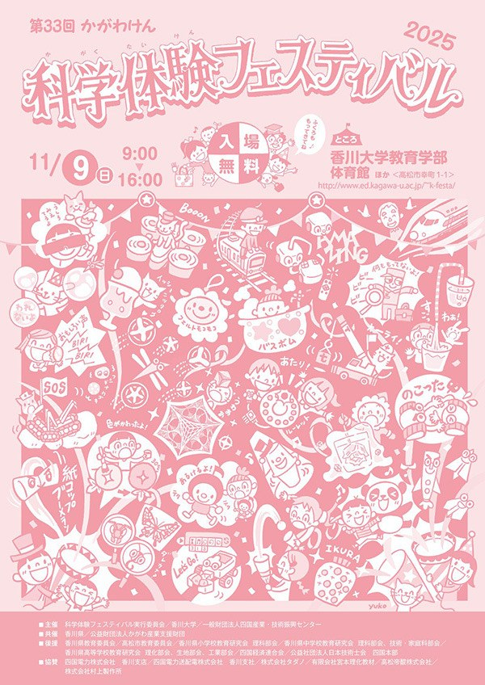
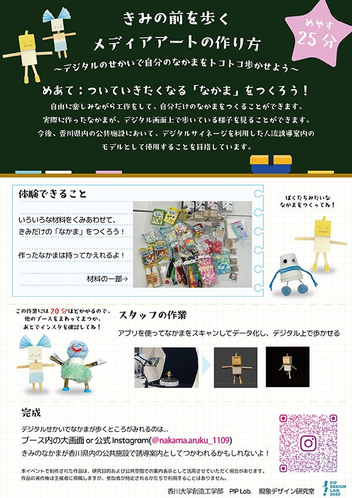
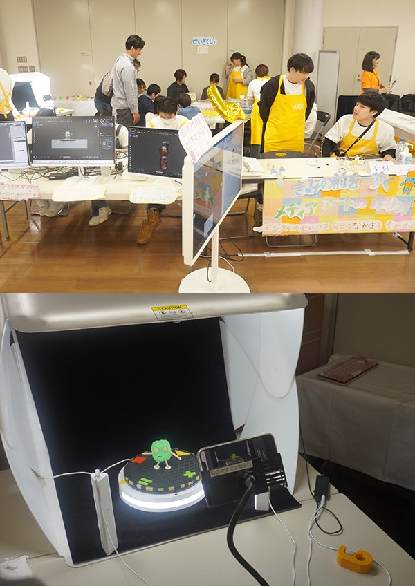

2025年11月9日（日）、香川大学幸町北キャンパスで開かれた「第33回かがわけん科学体験フェスティバル」に、現象デザイン研究室（北村研）がブースを出展しました。
このフェスティバルは、県内の子どもたちに科学や技術のおもしろさにふれてもらおうと1993年から毎年開催されているもので、例年およそ3,000人が来場します。今年は審査を経た高校・大学・企業の29団体が出展しました。

研究室のブースのテーマは『きみの前を歩くメディアアートの作り方』です。
子どもたちがつくった人のかたちの作品を取り込み、大きなスクリーンに映るデジタルの世界の中を歩かせました。作品をスキャンして骨格を付けていく様子も、その場で見てもらいました。
つくった作品はそのまま持ち帰ることができ、作品が歩く様子の動画はブースのInstagramにも投稿しました。

1日で55組以上（1組1〜3名）に体験していただき、しくみについて熱心に質問してくれる子どもたちの姿も見られました。

- ブース実行委員：豊平昌伸，新田宗史，丸岡宙央，上原睦，小西亜衣子，田中希和，大島郁織，對馬寛乃，横田沙羅，大野真誇，早川翔大
- 指導教員：北村尊義

この取り組みは、香川大学 造形・メディアデザインコースのWebサイトでも紹介しています。

- [第33回かがわけん科学体験フェスティバルに出展（香川大学 造形・メディアデザインコース）](https://www.kagawa-u.ac.jp/kagawa-u_ead/course/modeling/news/33815/)
- [かがわけん科学体験フェスティバル 公式サイト](https://www.ed.kagawa-u.ac.jp/~k-festa/index.html)
- [ブースのInstagram（nakama.aruku_1109）](https://www.instagram.com/nakama.aruku_1109)

