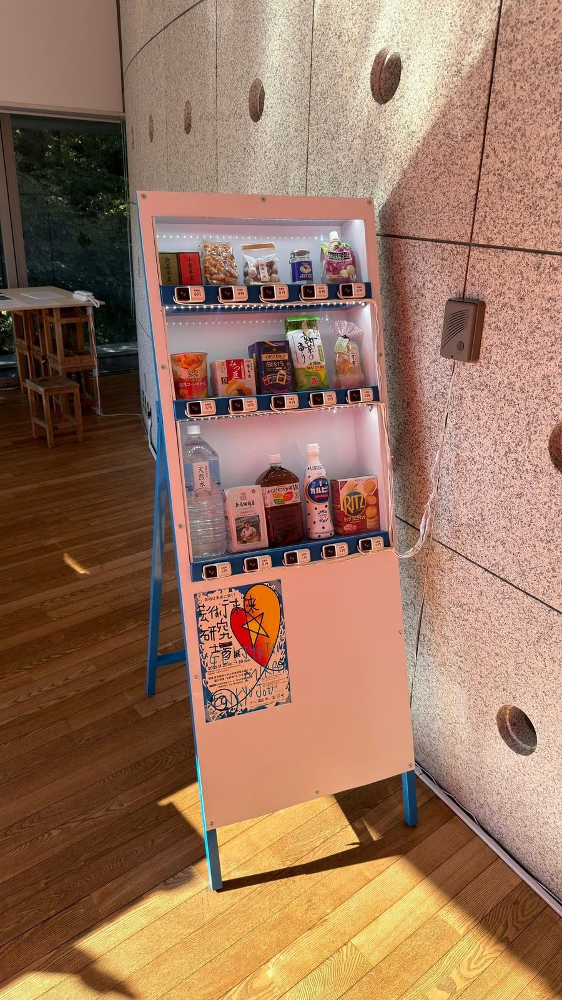
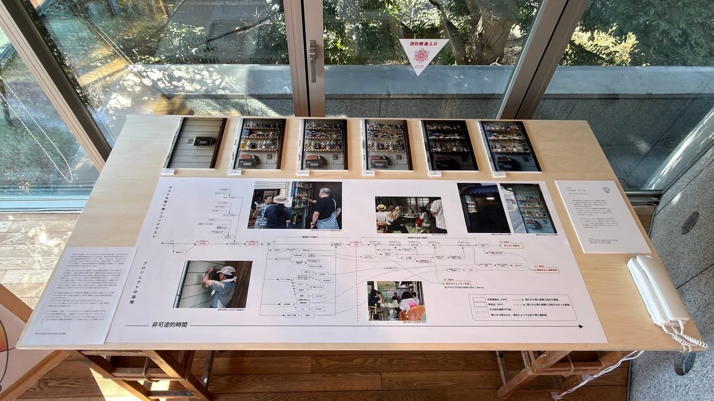
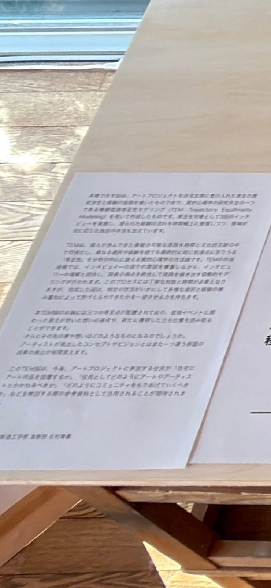

香川県東かがわ市引田に伝わる「お遍路さんへのおせったい文化」に対して、東京芸大研究員である馬場悠輔先生がアート活動を展開なさっており、北村はその地域住民との関係構築の記録の助言をさせていただいております。

こちらの分析には質的心理学の当該分野の権威である立命館大学総合心理学部サトウタツヤ先生にもご助言いただき、素敵な複線径路等至性モデリング(TEM)図が完成しました。

個人的にはTEMをUXの質的評価に簡易導入できないか学生らとの実験で検討してきたわけですが、このご縁のおかげでかなり本格的なTEMに関わることになりました。

写真は本日まで東京藝術大学大学美術館で展示されていた芸術未来研究場展（会期：2025年11月21日〜30日）での展示物としてシェアくださったものです。

[芸術未来研究場展（東京藝術大学）](https://geidai-park-exh.geidai.ac.jp/exhibition/2025_012/)

