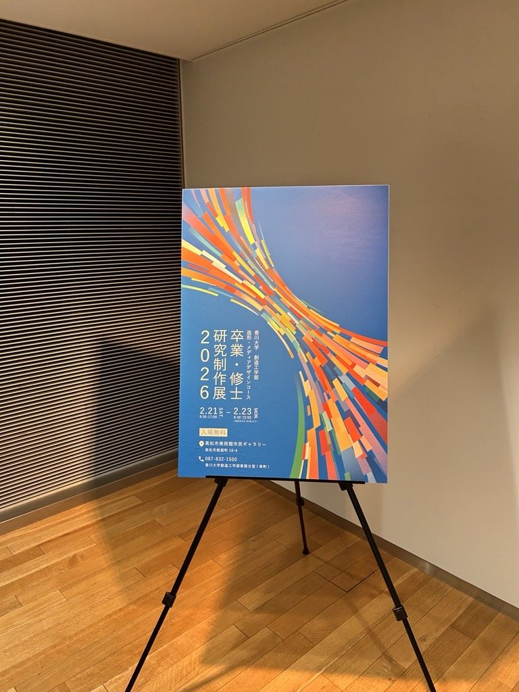
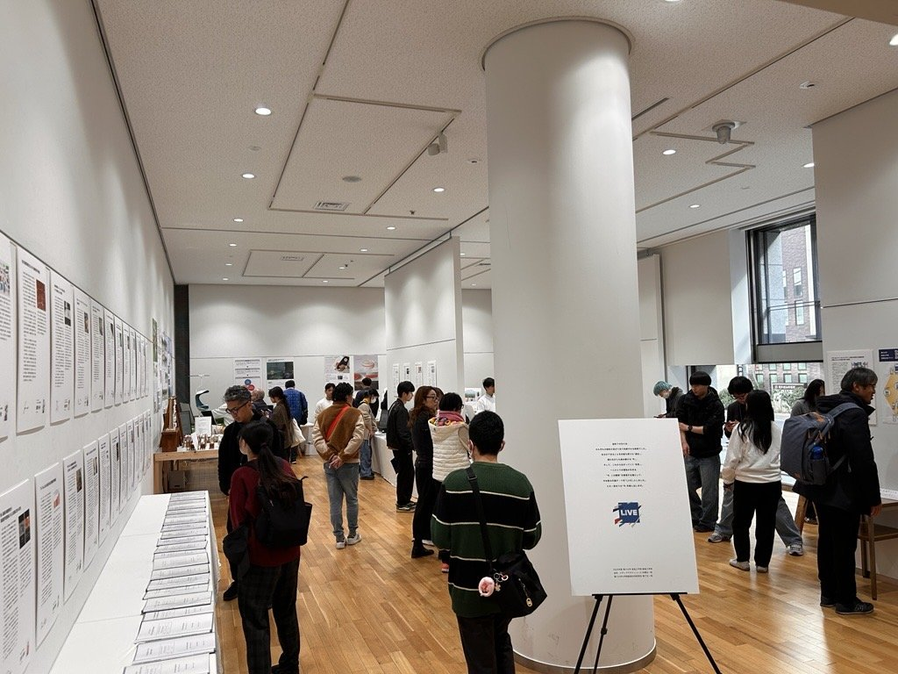
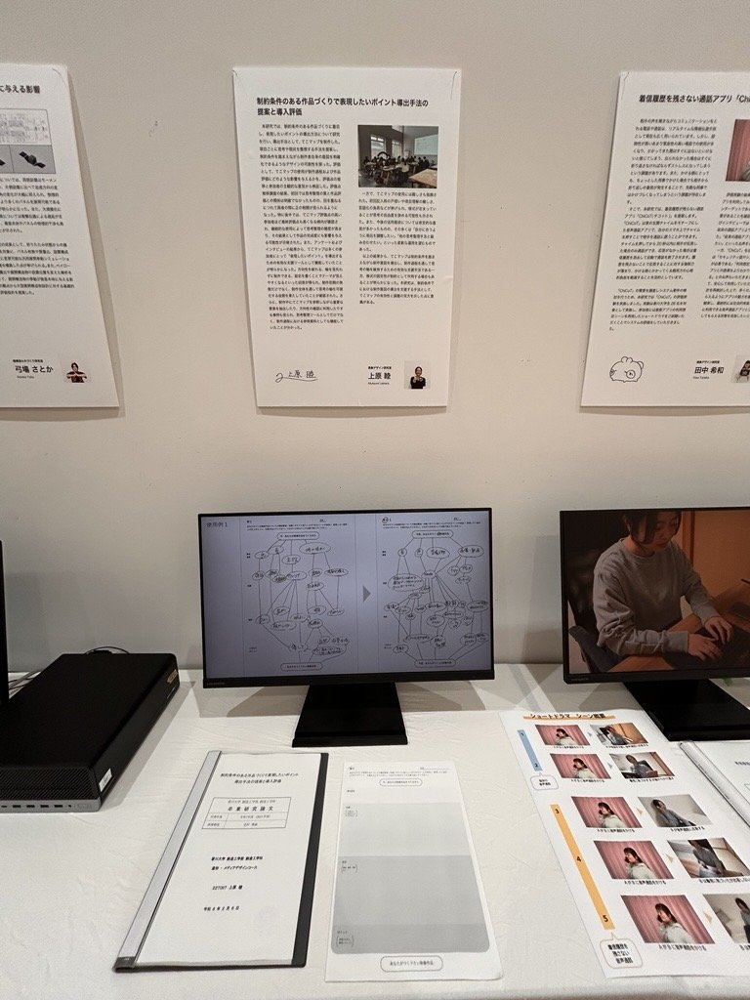
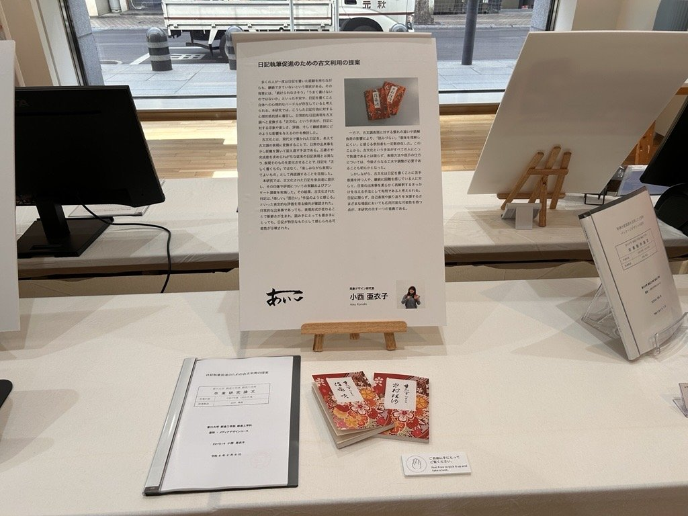
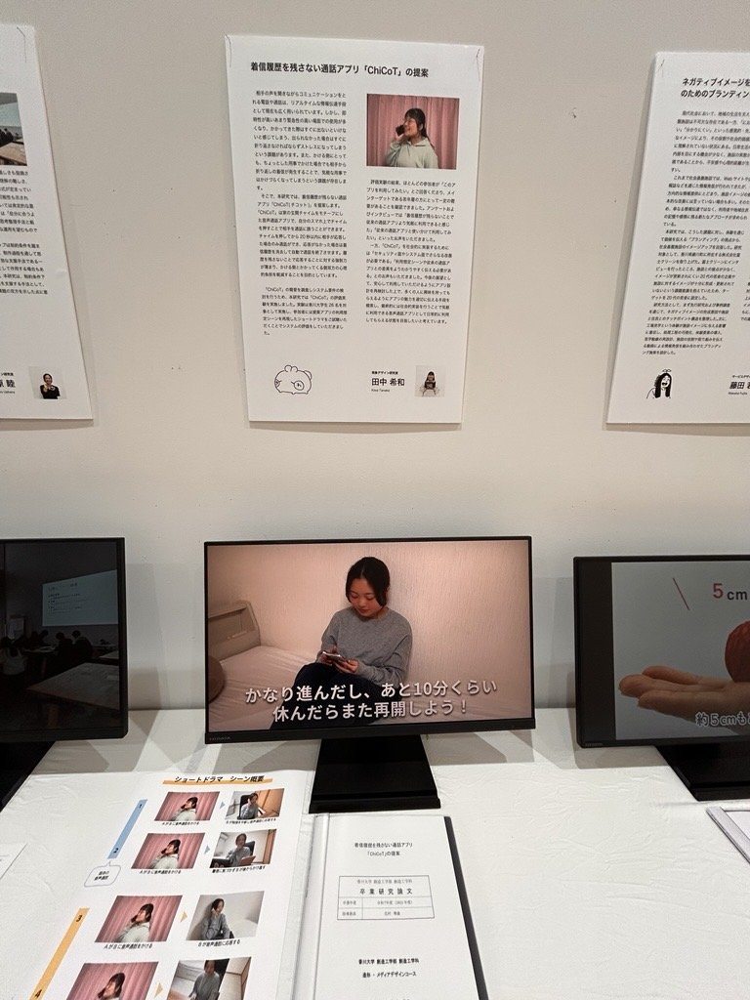

2026年2月21日(土)～23日(月・祝)は香川大学 創造工学部 造形・メディアデザインコース 卒業・修士研究制作展でした。北村はこの学年のCA（学年担任）でもあり、これまで見守ってきた学生さんらの展示を楽しませていただきました。

**卒業論文**

* 上原 睦: 制約条件のある作品づくりで表現したいポイント導出手法の提案と導入評価
* 小西 亜衣子: 日記執筆支援のための古文利用の提案
* 田中 希和: 着信履歴を残さない通話アプリ「ChiCoT」の提案

**修士論文**

* 豊平 昌伸: 小売店での無人会計シーンにおける制御感を損なわない情報提示要素の検討
* 新田 宗史: 電波天文学への直感的な理解を促す演習教材

[卒業・修士研究制作展のInstagram](https://www.instagram.com/sotsuten_zoukei/)

