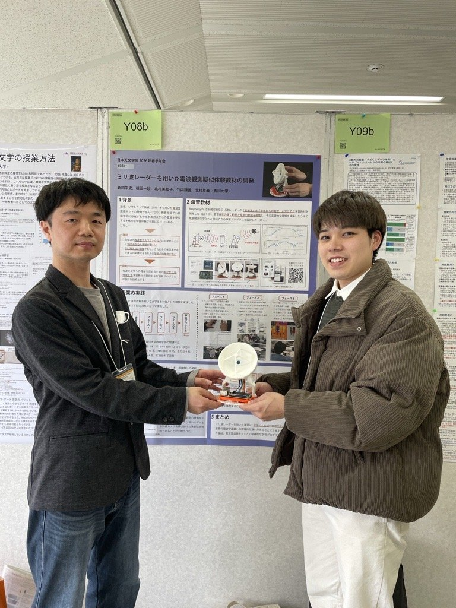

2026 年 3 月 4 日（水）〜 3 月 7 日（土）に京都産業大学にて日本天文学会が開催した春季年会にて、M2の新田さんが発表しました。写真は共著者の天文学者である徳田先生（左）と新田さん（右）です。

- Y08b ミリ波レーダーを用いた電波観測疑似体験教材の開発 新田宗史, 徳田一起, 北村美和子, 竹内謙善, 北村尊義（香川大学）

講演予稿集は[こちら](https://www.asj.or.jp/nenkai/archive/2026a/book.pdf)

