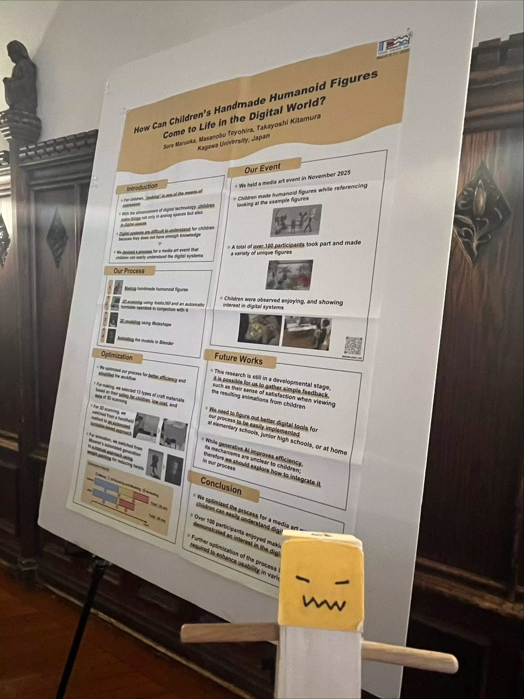
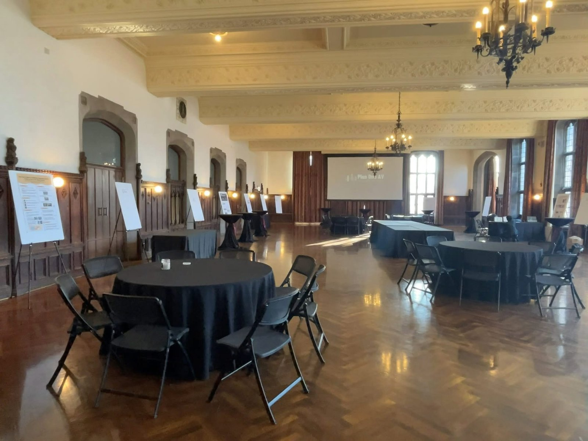
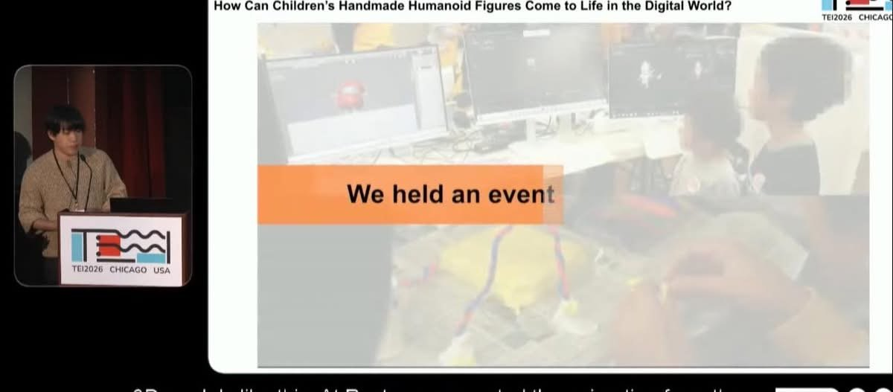

M1の丸岡宙央さんが、シカゴ大学で開催のACM TEI2026で発表しました。
彼にとっては初海外、初国際会議、しかも単身です。
内容はメディアアートの仕組みを深く知りたい子供向け科学コミュニケーションの実施報告でした。
歴史ある会場で、堂々と発表なさったことに感服です。
彼に優しく声かけしてくださった皆様方、本当にありがとうございました。

- Sora Maruoka, Masanobu Toyohira, Takayoshi Kitamura: [How Can Children's Handmade Humanoid Figures Come to Life in the Digital World?](https://doi.org/10.1145/3731459.3779319), Proceedings of the Twentieth International Conference on Tangible, Embedded, and Embodied Interaction (TEI 2026), pp.1-6 (2026).

[TEI 2026 公式サイト](https://tei.acm.org/2026/)

