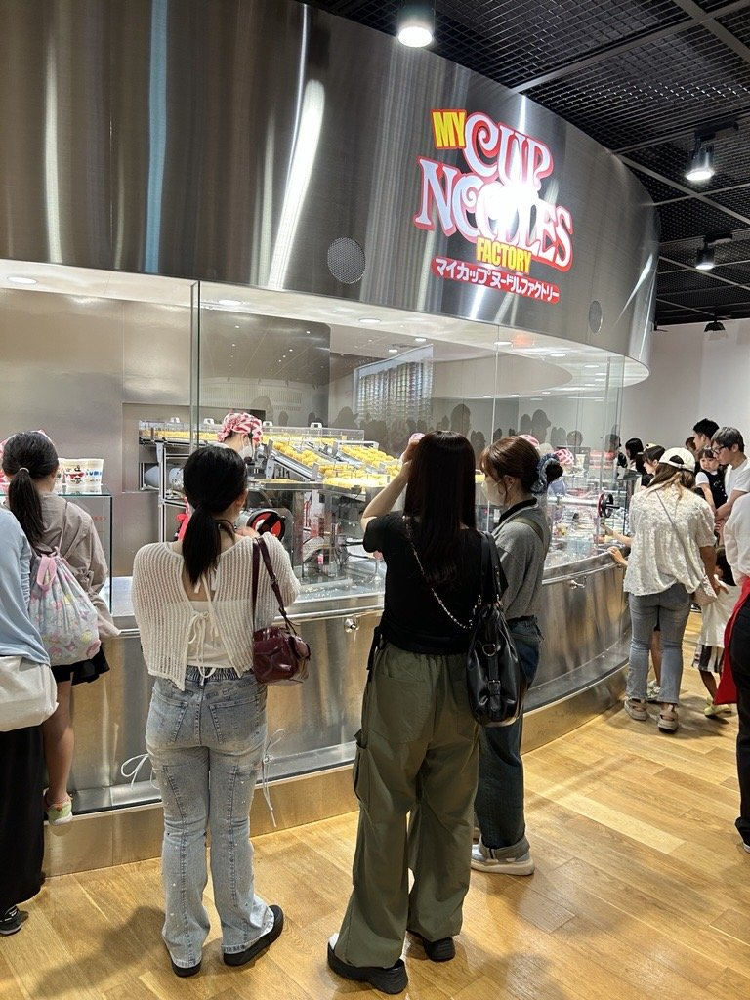
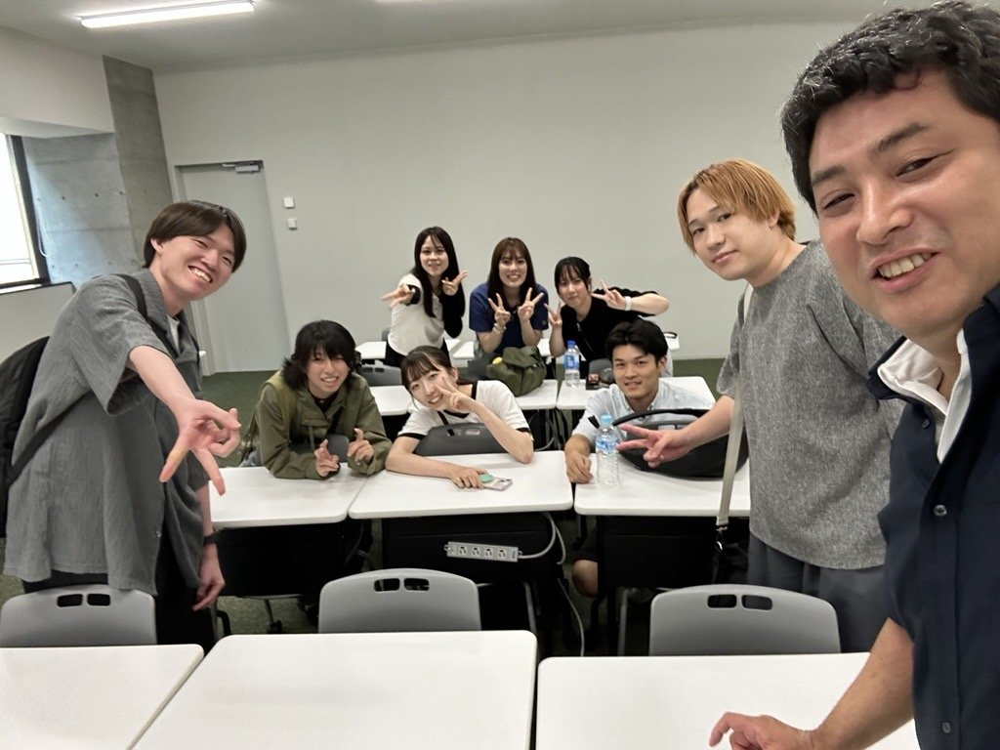

今年も2泊3日の研究室旅行を兼ねてヒューマンメディア合同研究会に参加してきました。
ポスター形式での発表だったのですが、教員採点で高橋さん、丸岡さんが優秀賞（大学院生の部）、對馬さんが優秀賞（学部生の部）、学生投票で横田さんが学生賞を受賞しました！

ヒューマンメディア合同研究会の詳細は[こちら](https://sites.google.com/view/hmedia-ws/hmedia2026)

